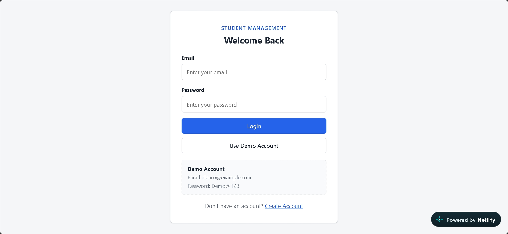
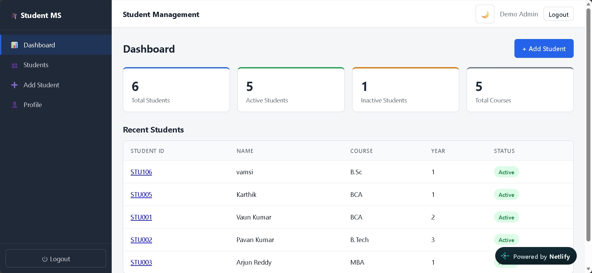
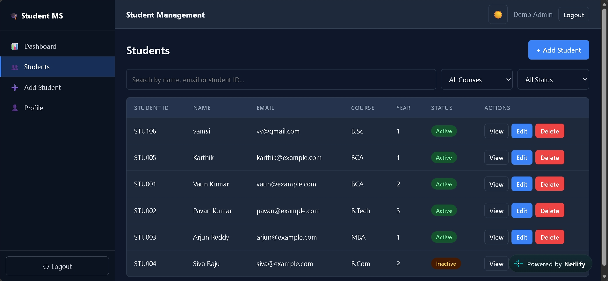

# Student Management System

A full-stack Student Management System that I built as a learning project. It has a React frontend, a Node.js/Express backend, and a MongoDB Atlas database. The application includes a login/register flow and pages for viewing and managing student records.

## Live Links

- **Live frontend:** https://student-management-system23.netlify.app/
- **Backend health check:** https://student-management-backend-a2i3.onrender.com/
- **GitHub repository:** https://github.com/vankayalavamsi/Student-Management-System

The backend health-check URL should return a small JSON response confirming that the API is running. It does not display the student management interface.

## Screenshots

The screenshots are stored in the repository's `screenshots` folder.

### Login Page



This is the entry page for users who already have an account. The login form sends the email and password to the backend. If the details are valid, the backend returns an authentication token that the frontend uses for protected requests.

### Dashboard



The dashboard is the main page after a successful login. It provides an overview of the student management system. The data shown on the dashboard comes from the application and its API, depending on the feature being displayed.

### Student Page



The student section is where student records can be viewed and managed. The backend supports creating, viewing, updating, searching/filtering, and deleting student records. Student records are stored in MongoDB Atlas through the backend.

> If the images do not appear on GitHub, check that the filenames and letter case match exactly: `screenshots/login.png`, `screenshots/dashboard.png`, and `screenshots/student.png`.

## Contents

- [Project Overview](#project-overview)
- [Features](#features)
- [Technology Stack](#technology-stack)
- [How the Application Works](#how-the-application-works)
- [How Data Is Stored in MongoDB Atlas](#how-data-is-stored-in-mongodb-atlas)
- [Project Structure](#project-structure)
- [Prerequisites](#prerequisites)
- [Clone and Run Locally](#clone-and-run-locally)
- [Set Up MongoDB Atlas](#set-up-mongodb-atlas)
- [Configure the Backend](#configure-the-backend)
- [Configure the Frontend for Local Development](#configure-the-frontend-for-local-development)
- [Run the Application](#run-the-application)
- [API Routes](#api-routes)
- [Deploy the Backend to Render](#deploy-the-backend-to-render)
- [Deploy the Frontend to Netlify](#deploy-the-frontend-to-netlify)
- [Troubleshooting](#troubleshooting)
- [Security Notes](#security-notes)
- [What I Learned](#what-i-learned)
- [Future Improvements](#future-improvements)
- [Author](#author)

## Project Overview

The purpose of this project is to make student information easier to organise through a web application. The frontend is the part users see and interact with. The backend processes requests, checks the data, handles authentication, and communicates with the database.

The frontend and backend are separate applications:

- **Frontend:** React, Vite, React Router, and Axios.
- **Backend:** Node.js, Express, Mongoose, JWT, and bcrypt.
- **Database:** MongoDB Atlas.

## Features

- User registration and login.
- Password hashing before saving user accounts.
- JSON Web Token (JWT) authentication for protected routes.
- View student records.
- Add a student record.
- Edit existing student information.
- Delete a student record.
- Search student records by name, email, or student ID.
- Filter records by course and status through the backend API.
- Validate required student fields on the backend.
- Prevent duplicate student IDs.
- Dashboard, student list, student details, add/edit student, and profile pages.
- Light/dark theme preference saved in the browser.
- Separate frontend and backend deployments.

The available UI features can change as the project is updated. The backend routes and data model define the operations supported by the current source code.

## Technology Stack

| Technology | Purpose |
|---|---|
| React | Builds the user interface |
| Vite | Runs the frontend development server and builds the production frontend |
| React Router | Handles navigation between pages |
| Axios | Sends HTTP requests from the frontend to the backend |
| Node.js | Runs the backend JavaScript code |
| Express.js | Defines API routes and handles HTTP requests |
| MongoDB Atlas | Hosts the database in the cloud |
| Mongoose | Defines data models and communicates with MongoDB |
| bcryptjs | Hashes passwords before they are stored |
| JSON Web Token (JWT) | Supports authenticated API requests |
| dotenv | Loads backend settings from a `.env` file |
| CORS | Controls which browser origins can call the API |
| Git and GitHub | Store and manage the source code |
| Render | Hosts the backend API |
| Netlify | Hosts the frontend |

## How the Application Works

The main request flow is:

```text
User opens the website
        |
        v
React frontend (Netlify or localhost)
        |
        | HTTP request using Axios
        v
Express backend (Render or localhost)
        |
        | Mongoose model/query
        v
MongoDB Atlas
        |
        | Query result / saved document
        v
Express sends a JSON response
        |
        v
React updates the page
```

The browser should not connect directly to MongoDB Atlas. The database connection string stays on the backend, and the backend is responsible for reading and writing database records.

### Example: Adding a student

1. A user fills in the student form in the frontend.
2. The frontend sends the student details to the backend API.
3. The backend checks that required fields are present and that the student ID is not already in use.
4. The backend uses the Mongoose `Student` model to create a document in MongoDB.
5. MongoDB stores the record in the database.
6. The backend returns the result to the frontend.
7. The frontend refreshes the list or displays the result.

### Example: Logging in

1. A user enters their email and password.
2. The frontend sends them to `POST /api/auth/login`.
3. The backend finds the account and compares the entered password with the stored password hash.
4. If the credentials are correct, the backend returns a JWT and basic user information.
5. The frontend stores the token in browser local storage.
6. Axios sends the token in the `Authorization: Bearer <token>` header for protected API calls.

Passwords are hashed before being stored. A password hash is not the same as storing the original plain-text password.

## How Data Is Stored in MongoDB Atlas

MongoDB is a document database. Instead of rows in a relational table, it stores JSON-like documents inside collections. MongoDB Atlas is the cloud-hosted MongoDB service used by this project.

### Collections and models

The backend defines two main Mongoose models:

- **User:** stores account details such as name, email, password hash, and role.
- **Student:** stores student details.

A student document includes fields such as:

- `studentId`
- `fullName`
- `email`
- `phone`
- `gender`
- `dateOfBirth`
- `course`
- `year`
- `address`
- `enrollmentDate`
- `status`

Mongoose also adds `createdAt` and `updatedAt` timestamps to student and user documents. Student IDs are required and unique. User emails are also required and unique.

Example of the shape of a student document (sample data only):

```json
{
  "studentId": "STU100",
  "fullName": "Sample Student",
  "email": "student@example.com",
  "phone": "9000000000",
  "gender": "Other",
  "dateOfBirth": "2004-01-15",
  "course": "B.Tech",
  "year": "2",
  "address": "Hyderabad",
  "enrollmentDate": "2025-08-01",
  "status": "Active"
}
```

MongoDB will also add its own `_id` field to each document. Do not use the sample record above as real personal information.

### What happens when I add, edit, or delete a student?

- **Add:** the backend creates a new document in the students collection.
- **View:** the backend queries MongoDB and returns the matching documents.
- **Edit:** the backend updates the document with the matching MongoDB ID.
- **Delete:** the backend removes the matching document from the collection.
- **Search/filter:** the backend queries MongoDB using the supplied search or filter values.

Because the records are stored in Atlas, they remain there after a browser refresh or after the frontend is closed. They are not stored only in the React page.

## Project Structure

The repository is organised into separate frontend, backend, and screenshot folders. The important backend files include:

```text
Student-Management-System/
├── backend/
│   ├── config/
│   │   └── db.js                 # Connects Mongoose to MongoDB
│   ├── controllers/
│   │   ├── authController.js     # Registration and login logic
│   │   └── studentController.js  # Student CRUD and search logic
│   ├── middleware/
│   │   └── authMiddleware.js     # Checks authentication tokens
│   ├── models/
│   │   ├── User.js               # User schema and password hashing
│   │   └── Student.js            # Student schema
│   ├── routes/
│   │   ├── authRoutes.js         # Authentication endpoints
│   │   └── studentRoutes.js      # Protected student endpoints
│   ├── server.js                 # Express server entry point
│   └── package.json              # Backend dependencies and scripts
├── frontend/
│   ├── src/
│   │   ├── components/           # Shared UI components
│   │   ├── pages/                # Login, dashboard, student and profile pages
│   │   ├── services/
│   │   │   └── api.js             # Axios API configuration
│   │   ├── App.jsx               # Main routes and application layout
│   │   └── main.jsx              # React entry point
│   ├── index.html
│   ├── vite.config.js
│   └── package.json              # Frontend dependencies and scripts
├── screenshots/
│   ├── login.png
│   ├── dashboard.png
│   └── student.png
└── README.md
```

## Prerequisites

Install these before running the project:

1. **Git:** to clone the repository.
2. **Node.js and npm:** to run the frontend and backend. Use a current supported LTS version of Node.js.
3. **A code editor:** Visual Studio Code is a good option.
4. **MongoDB Atlas account:** required if you want to use the cloud database.
5. **A web browser:** for opening the frontend.

Check that Node.js and npm are installed:

```bash
node -v
npm -v
git --version
```

## Clone and Run Locally

### Step 1: Clone the GitHub repository

Open a terminal and run:

```bash
git clone https://github.com/vankayalavamsi/Student-Management-System.git
cd Student-Management-System
```

Cloning downloads a copy of the project files to your computer. It does not download the production database or its private credentials.

### Step 2: Install backend packages

```bash
cd backend
npm install
```

The backend `package.json` includes the required packages, including Express, Mongoose, bcryptjs, JSON Web Token, CORS, and dotenv.

### Step 3: Create the backend environment file

Inside the `backend` folder, create a file named `.env`. This file contains private configuration values used by the backend.

Use this template and replace the placeholder values with your own:

```env
PORT=5000
MONGO_URI=mongodb+srv://<database-user>:<database-password>@<your-cluster-host>/<database-name>?retryWrites=true&w=majority
JWT_SECRET=replace_this_with_a_long_random_secret
FRONTEND_URL=http://localhost:5173
NODE_ENV=development
```

Important:

- `MONGO_URI` must be your own MongoDB Atlas connection string.
- Replace the username, password, cluster host, and database name placeholders.
- If your database password contains special characters, URL-encode them in the connection string.
- `JWT_SECRET` should be a long, random secret. Do not use the example text as your real secret.
- `FRONTEND_URL` must match the local frontend origin. If Vite chooses a different port, update this value.
- Do not commit `.env` to GitHub.

The backend code reads `MONGO_URI` when connecting to MongoDB and reads `FRONTEND_URL` to configure CORS.

### Step 4: Set up the frontend

Open a second terminal from the project root and run:

```bash
cd frontend
npm install
```

The frontend's Axios configuration currently points to the deployed Render API. To test against the backend running on your own computer, edit:

`frontend/src/services/api.js`

Change the base URL from:

```js
baseURL: 'https://student-management-backend-a2i3.onrender.com/api',
```

to:

```js
baseURL: 'http://localhost:5000/api',
```

Save the file. This makes local frontend requests go to your local backend. When you want the frontend to use the deployed service again, restore the Render URL.

**Note:** This project currently hardcodes the API base URL in `frontend/src/services/api.js`. If you later want to switch between local and production settings without editing source code each time, you can change the app to use a Vite environment variable such as `import.meta.env.VITE_API_URL`.

### Step 5: Start the backend

In the terminal that is inside the `backend` folder, run:

```bash
npm run dev
```

The development script uses Nodemon to restart the backend when its files change. You can also use:

```bash
npm start
```

The API uses port `5000` by default. The server attempts to connect to MongoDB before it starts listening. If the database connection fails, check your Atlas URI and network access settings.

### Step 6: Start the frontend

In the second terminal, inside the `frontend` folder, run:

```bash
npm run dev
```

Vite will print a local URL, normally:

```text
http://localhost:5173
```

Open that URL in your browser.

### Step 7: Create an account and test it

1. Open the local frontend.
2. Register an account using the registration page.
3. Log in using that account.
4. Open the dashboard and student section.
5. Add a test student record.
6. Refresh the page and confirm the record is still present.
7. Edit the test record and check the updated values.
8. Delete the test record if you no longer need it.

The registration request creates a user in the database configured by your local backend. If your local `.env` points to your Atlas cluster, the new account and student records will be stored in that Atlas database.

## Set Up MongoDB Atlas

Follow these steps if you do not already have an Atlas database.

### Step 1: Create an Atlas account and project

1. Open the official MongoDB Atlas website: https://www.mongodb.com/atlas/database
2. Sign in or create an account.
3. Create a project for this Student Management System.
4. Create a database deployment/cluster. A free tier may be available depending on your region and Atlas's current offering.

### Step 2: Create a database user

1. In Atlas, open **Database Access**.
2. Create a database user with a username and a strong password.
3. Save these credentials securely. They are for the application's database connection and are different from your website login account.
4. Give the user only the database permissions needed for this project.

Do not use your Atlas website login password as the database password.

### Step 3: Configure network access

1. Open **Network Access** in Atlas.
2. Add the IP address from which your backend will connect.
3. For local development, allow your current public IP address.
4. For Render, configure network access so the deployed backend can reach Atlas. If you choose to allow access from all IP addresses (`0.0.0.0/0`), understand that it increases exposure and must be paired with a strong database user/password and appropriate database permissions. Prefer a narrower allowlist where practical.

If Atlas blocks the connection, check this setting first.

### Step 4: Copy the connection string

1. Open the cluster's **Connect** option.
2. Choose the option for connecting your application.
3. Copy the MongoDB connection string.
4. Replace the username, password, and cluster placeholders with the correct values.
5. Add a database name in the path if one is not already included.

It will look similar to this:

```text
mongodb+srv://<database-user>:<database-password>@<your-cluster-host>/<database-name>?retryWrites=true&w=majority
```

This is only a template, not a working connection string. Use the URI generated for your own cluster.

### Step 5: Put the URI in `backend/.env`

```env
MONGO_URI=mongodb+srv://<database-user>:<database-password>@<your-cluster-host>/<database-name>?retryWrites=true&w=majority
```

Replace the placeholders. Do not put this connection string in frontend code, screenshots, a public README, or a public GitHub commit.

### Step 6: Start the backend and verify the connection

From the `backend` directory:

```bash
npm run dev
```

The backend should log a message indicating that MongoDB has connected and that the server is running. If it exits with a database connection error, verify:

- The URI is correct.
- The database username and password are correct.
- Special characters in the password are URL-encoded.
- Your IP address is allowed in Atlas Network Access.
- The cluster is running and reachable.
- `MONGO_URI` is spelled exactly as expected in `.env`.

### Step 7: Confirm that data is being saved

1. Log in to the application.
2. Add a test student through the UI.
3. Open MongoDB Atlas.
4. Open **Database** or **Browse Collections** for your cluster.
5. Find the database named in your connection string.
6. Look for the student collection, normally named `students` by Mongoose.
7. Open the collection and check the new document.

The collection may not appear until the first student record is created. Mongoose creates collections as data is written, subject to its normal collection naming behaviour.

### Which database does the app use?

The database name comes from the database path in `MONGO_URI`. For example, if your URI ends with `/student_management?...`, that database name will generally be `student_management`. Choose a name and keep it consistent.

**Local code + Atlas database:** If `backend/.env` contains the Atlas connection string, the backend running on your computer writes to Atlas. You do not need to install MongoDB locally for that setup.

**Local code + local database:** If you instead configure a local MongoDB server, the backend writes to that local database. It will be separate from Atlas.

## Configure the Backend

The backend environment variables used by this project are:

| Variable | Purpose | Local example |
|---|---|---|
| `PORT` | Port used by Express | `5000` |
| `MONGO_URI` | MongoDB connection string | Your Atlas URI |
| `JWT_SECRET` | Secret used to sign login tokens | A long random secret |
| `FRONTEND_URL` | Allowed frontend origin(s) for CORS | `http://localhost:5173` |
| `NODE_ENV` | Runtime environment label | `development` |

For multiple allowed frontend origins, `FRONTEND_URL` can be a comma-separated list of origins, as supported by the backend configuration. Do not add trailing paths such as `/login`; use the origin only, for example `https://your-site.netlify.app`.

## Run the Application

You need two terminals running at the same time.

**Terminal 1, backend:**

```bash
cd Student-Management-System/backend
npm install
npm run dev
```

**Terminal 2, frontend:**

```bash
cd Student-Management-System/frontend
npm install
npm run dev
```

Open the URL Vite prints, usually `http://localhost:5173`.

For local development, confirm that `frontend/src/services/api.js` points to `http://localhost:5000/api` and that `backend/.env` contains `FRONTEND_URL=http://localhost:5173`.

## API Routes

The backend routes are organised under `/api/auth` and `/api/students`.

### Authentication

| Method | Endpoint | Purpose | Access |
|---|---|---|---|
| `POST` | `/api/auth/register` | Create a user account | Public |
| `POST` | `/api/auth/login` | Log in and receive a JWT | Public |
| `GET` | `/api/auth/me` | Return the current authenticated user | JWT required |

### Student records

| Method | Endpoint | Purpose | Access |
|---|---|---|---|
| `GET` | `/api/students` | Get student records; supports search/course/status filters | JWT required |
| `POST` | `/api/students` | Create a student record | JWT required |
| `GET` | `/api/students/:id` | Get one student record | JWT required |
| `PUT` | `/api/students/:id` | Update a student record | JWT required |
| `DELETE` | `/api/students/:id` | Delete a student record | JWT required |

For local development, the base API URL is:

```text
http://localhost:5000/api
```

The deployed base API URL is:

```text
https://student-management-backend-a2i3.onrender.com/api
```

Student endpoints require a valid JWT in the `Authorization` header. A direct browser visit to a protected endpoint may return an authorization error, which is expected when no token is supplied.

## Deploy the Backend to Render

The live backend is hosted on Render. These are the general steps to deploy a fresh copy or update the existing service.

### Step 1: Push your latest code to GitHub

Commit and push the backend and frontend changes to your repository. Make sure `.env` is not included in the commit.

### Step 2: Create a Render Web Service

1. Sign in to https://render.com/
2. Choose to create a new **Web Service**.
3. Connect the GitHub repository.
4. Set the **Root Directory** to `backend`.
5. Set the **Build Command** to `npm install`.
6. Set the **Start Command** to `npm start`.
7. Select an appropriate instance plan.

### Step 3: Add backend environment variables in Render

In the service's environment settings, add:

```text
MONGO_URI = your real MongoDB Atlas connection string
JWT_SECRET = your long random secret
FRONTEND_URL = https://student-management-system23.netlify.app
NODE_ENV = production
```

You can also set `PORT` if required, but Render normally supplies the port environment variable for web services. The server code uses `process.env.PORT` and falls back to `5000`.

Do not paste real secrets into this README or commit them to GitHub.

### Step 4: Deploy and check the API

Deploy the service and wait for the build to finish. Open:

https://student-management-backend-a2i3.onrender.com/

The root endpoint should return JSON similar to:

```json
{
  "success": true,
  "message": "Student Management System API is running...",
  "environment": "production"
}
```

This checks that the server is running. It does not by itself prove that login and all database operations work, so test those through the frontend as well.

### Step 5: Check the Atlas connection

Confirm that Render has the correct `MONGO_URI`, and that Atlas network access permits the Render service to connect. If you change an environment variable, redeploy or restart the service as required by Render.

### Optional: Demo seed data

The backend contains optional demo-data seeding logic controlled by `SEED_DEMO_DATA=true`. It is disabled unless explicitly enabled. If you enable it, the code can create a demo admin account and sample student records when the relevant records do not already exist. Use this only for a demo/test database, understand the sample credentials in the source code, and do not enable it on a production database containing real data.

## Deploy the Frontend to Netlify

The live frontend is hosted on Netlify.

### Step 1: Create a Netlify site

1. Sign in to https://www.netlify.com/
2. Add a new site by importing the GitHub repository.
3. Set the **Base directory** to `frontend`.
4. Set the **Build command** to `npm run build`.
5. Set the **Publish directory** to `dist`.
6. Start the deployment.

### Step 2: Confirm the API URL

The current frontend file `frontend/src/services/api.js` points to:

```text
https://student-management-backend-a2i3.onrender.com/api
```

That is correct for the current deployed backend. If you deploy your own backend with a different URL, update the Axios base URL to use your new backend's `/api` URL and redeploy the frontend.

### Step 3: Configure CORS

In the Render backend environment variables, make sure `FRONTEND_URL` matches the exact deployed Netlify origin:

```text
https://student-management-system23.netlify.app
```

If you use a different Netlify site URL or a custom domain, update `FRONTEND_URL` accordingly. Then restart/redeploy the backend if needed.

### Step 4: Test the live application

- Open the Netlify frontend.
- Register or log in.
- Add a test student.
- Refresh and confirm that the record remains.
- Check that edit and delete operations work.
- If something fails, check the browser console, Network tab, Render logs, and Atlas connection.

## Troubleshooting

### 1. `MongoDB connection error`

Check the `MONGO_URI` value, Atlas database user, password, IP access list, and cluster status. Make sure `.env` is inside the `backend` directory.

### 2. `Cross-origin request not allowed` or a CORS error

Make sure `FRONTEND_URL` exactly matches the frontend origin. Use the scheme and domain only, without a page path. For local development, it is usually `http://localhost:5173`.

### 3. The frontend opens but cannot load students

Check the API base URL in `frontend/src/services/api.js`. For local development it should point to `http://localhost:5000/api`; for the live app it should point to the deployed backend `/api` URL.

### 4. Login works but student pages return `401 Unauthorized`

Student routes are protected. Check that the frontend has a valid login token and that the `JWT_SECRET` has not changed between token creation and validation. Log out and log in again after changing the secret.

### 5. The student list is empty

Make sure the backend connects to the intended Atlas database and that the student collection contains records. A new database may start empty. Create a test record through the application.

### 6. `npm` or `node` is not recognised

Install Node.js, close and reopen the terminal, and check `node -v` and `npm -v`.

### 7. The Render backend takes time to respond

Some hosting plans may pause services after inactivity. Wait for the service to start, then retry the request.

### 8. Screenshots do not show on GitHub

Check that the image files exist in `screenshots/` and use the exact lowercase filenames referenced in this README.

## Security Notes

- Never commit `.env` or database credentials to GitHub.
- Never put the MongoDB URI or JWT secret in frontend code.
- Use a strong database password and a long, random `JWT_SECRET`.
- Use a least-privilege database user.
- Restrict Atlas network access where practical.
- Do not use demo accounts or sample student information for real personal data.
- Use HTTPS for public deployments.
- The frontend stores the JWT in browser local storage. This is convenient for a learning project, but any application using local storage should take cross-site scripting (XSS) risks seriously.

## What I Learned

While making this project, I practised:

- Building pages using React.
- Connecting React to an API with Axios.
- Creating API routes with Express.
- Using Mongoose models to validate and save records.
- Connecting a backend to MongoDB Atlas.
- Implementing login, password hashing, and JWT authentication.
- Performing create, read, update, and delete operations.
- Managing frontend/backend configuration.
- Deploying a frontend and backend separately.
- Using GitHub to store and share project code.

## Future Improvements

- Move the frontend API URL to an environment variable.
- Add automated tests for API routes and UI flows.
- Improve form validation and error messages.
- Add pagination for larger student lists.
- Add more detailed API documentation.
- Add stronger security protections and review authentication/storage choices.
- Improve monitoring and backup procedures for the database.

## Author

**Vankayalavamsi**

This is a learning project that I can continue improving as I learn more about full-stack web development.
